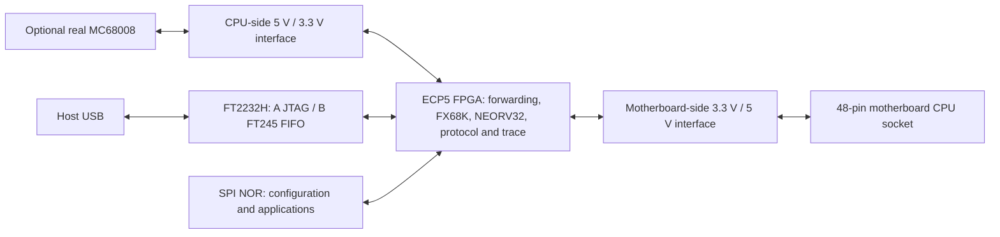

# MC68008 In-Circuit Emulator and Bus Analyzer

An open-source FPGA adapter for diagnosing and repairing computers built around
the **48-pin MC68008**. The board sits between the motherboard's CPU socket and
an optional real processor. It can observe the machine, debug it using the real
CPU, or replace the CPU with an FPGA implementation.

The project is at the requirements and initial schematic stage. FPGA logic,
firmware, host tools, and a PCB layout have not been implemented. The
[project specification](requirements/MC68008_ICE_Project_Specification_2026-11-04.md)
is the design baseline; the [KiCad starter](kicad/README.md) records the current
hardware work and unresolved decisions.

The schematic now connects all bus receivers, drivers, control signals, and the
FT245 interface to FPGA balls. Pin selection favors the outer BGA rings, with
matching assignments in [the pin table](kicad/fpga_pins.csv) and
[LPF constraints](kicad/68008ice.lpf). Power connections use KiCad power symbols.

## Operating ideas

| Mode | Execution engine | Intended behavior |
| --- | --- | --- |
| Transparent analyzer | Physical MC68008 | Forward the bus combinationally and record activity with programmable triggers. |
| Active real-CPU debugger | Physical MC68008 | Intercept or inject bus responses, instructions, interrupts, and exceptions; provide virtual debugger memory and register capture. |
| In-circuit emulator (ICE) | FX68K in the FPGA | Drive the motherboard through an 8-bit bus adapter, with halt, step, inspection, and diagnostic accesses. |

Correct instruction execution and valid external bus cycles take priority over
matching the original processor's internal instruction timing. Comparing the
physical and emulated CPUs in tandem, and building a standalone CPU test
fixture, are future ideas outside the initial scope.

## Hardware architecture

The two bus interfaces remain electrically separate. In analyzer mode, forwarding
passes through input buffers, combinational FPGA logic, and output buffers;
sampling registers are outside that path. Capture logic samples both sides at
approximately **50 MHz**, with a circular buffer and configurable pre/post-trigger
history. Triggers include masked address/data, read/write, function code, bus
error, and DTACK timeout. Both raw samples and compact transaction/event records
are planned.

- **FPGA:** Lattice ECP5-25F, preferably CABGA-256. Its 1,008 Kbit / 126 KiB of
  embedded RAM is shared by CPU needs, debugger memory, and trace capture. Move
  to ECP5-45F only if the complete design does not fit.
- **Bus translation:** 3.3 V-powered 74LVC541A receivers and 5 V-powered
  74AHCT541 drivers, with separate FPGA input, output, and output-enable nets.
  The specification's initial eight-receiver/eight-driver estimate needs
  refinement against sensing coverage and independently enabled groups.
- **Ownership:** drivers start disabled and must remain safe through
  configuration, mode changes, and DMA handoff. RESET and HALT need separate
  sensing and open-drain low drivers on each side. CPU-side DTACK, BERR, VPA,
  and interrupt inputs must be independently interceptable.
- **48-pin variant:** A0–A19, D0–D7, one DS strobe, two interrupt inputs
  (IPL1 and combined IPL2/IPL0), and two-wire BR/BG arbitration. There is no
  BGACK pin. See the [Motorola user manual](https://www.nxp.com/docs/en/reference-manual/MC68000UM.pdf).
- **Host connection:** one FT2232H, with channel A for MPSSE/JTAG and channel B
  for the 8-bit **asynchronous FT245 FIFO**, including RXF#, TXE#, RD#, WR#,
  and preferably SIWU#. An EEPROM selects the FTDI configuration.
- **Configuration:** SPI NOR stores the FPGA bitstream, an application
  directory, and firmware images. FPGA-controlled updates and an independent
  JTAG recovery header are planned.
- **Power and USB:** all circuitry, including the FT2232H, runs from the target
  motherboard's +5 V. Proposed regulators provide 1.1 V / 3 A, 3.3 V / 1 A,
  and 2.5 V / 500 mA. USB-C VBUS is sensed through MOSFET gates and never feeds
  a board supply. Independent rail supervision, configuration status and an
  explicit arm request qualify bus drive; receivers also stay off until FPGA
  supplies are valid. See the [hardware notes](kicad/README.md) for the circuit
  and outstanding power-budget and startup validation.
- **Board:** four-layer KiCad PCB, targeting JLCPCB fabrication and assembly
  subject to BGA breakout, placement, and manufacturing constraints.

## FPGA, firmware, and host software

**FX68K** supplies the emulated 68000 execution engine while retaining its
microcode and nanocode. A new adapter converts a logical 16-bit word transfer
into two MC68008 byte transfers and withholds completion until both finish.
Prefetch, errors, interrupts, VPA cycles, read-modify-write, and DMA handoff all
need verification.

**NEORV32** runs the debugger firmware. An FPGA-initialized bootloader loads one
task-specific application at a time from SPI flash, using a fixed directory of
application ID, offset, length, and CRC32. Initial memory budgets are 8 KiB boot
ROM, 16 KiB writable instruction RAM, and 4 KiB data RAM, subject to compiled
sizes. Direct application upload through FT245 is also planned.

Application selection uses a hardware mailbox followed by a **NEORV32-only
reset**. Bus ownership, output safety, operating mode, trace contents, FT245
protocol state, and the selection mailbox remain in hardware outside that reset
domain. Flash updates need protection for the FPGA configuration region and a
JTAG recovery route.

**FPGA RTL owns the host protocol:** FT245 handshaking, FIFOs, framing, escaping,
CRC32, and command dispatch. Frames carry message type, command ID, sequence
number, payload length, and CRC32, with an initial payload limit of 256 bytes.
Length, command, and integrity checks complete before any action executes.

| Escaped bytes | Meaning |
| --- | --- |
| `FF 00` | Start frame |
| `FF 01` | End frame |
| `FF 02` | Abort / resynchronize |
| `FF FF` | Literal `FF` within frame contents |

Simple control commands execute in hardware; higher-level commands reach
NEORV32 through an interrupting mailbox. Trace data streams directly from FPGA
memory into the framed transmitter. Responses, trace chunks, and events share
one serialized output so frames cannot interleave. Host tools will use
**libftdi/libusb** for control, decoding, disassembly, and diagnostics.

Real-CPU debugging will use forward/suppress/inject selection and a small virtual
instruction/stack window. Register capture is intended to inject an exception
handler and restore state with `RTE` where safe, accounting for USP/SSP and
prefetch. Ordinary 68000/68008 bus-error exceptions cannot generally restart an
interrupted instruction; BERR + HALT bus retry is a separate mechanism with
restrictions.

## Development path

1. Synthesize FX68K, NEORV32, FT245 framing, bus control, and trace infrastructure
   together for ECP5-25F; establish logic, I/O, timing, and RAM budgets.
2. Simulate one logical word read as two correctly timed byte transactions,
   then extend verification to waits, errors, interrupts, and arbitration.
3. Complete schematic power, clocking, and output interlocks; validate pin allocation;
   review electrical rules and target timing before PCB layout.
4. Bring up transparent forwarding and capture on hardware, then real-CPU
   interception, followed by ICE operation.

The intended toolchain is **Yosys, nextpnr-ecp5, Project Trellis,
openFPGALoader, Verilator, and Makefiles** on macOS and Linux. The main risks are
BGA breakout and power layout, forwarding delay and data/DTACK timing, bus
contention, exception restoration, and FX68K behavior under extended waits.

## Repository and references

- [`requirements/`](requirements/) — original project specification.
- [`kicad/`](kicad/) — initial schematic project and hardware notes.
- [AtomBusMon](https://github.com/hoglet67/AtomBusMon) — starting architectural reference.
- [FX68K](https://github.com/ijor/fx68k) — proposed CPU core.
- [NEORV32](https://github.com/stnolting/neorv32) — selected debug processor.

The repository is licensed under [Apache License 2.0](LICENSE). Referenced
third-party cores and tools retain their own licenses.
