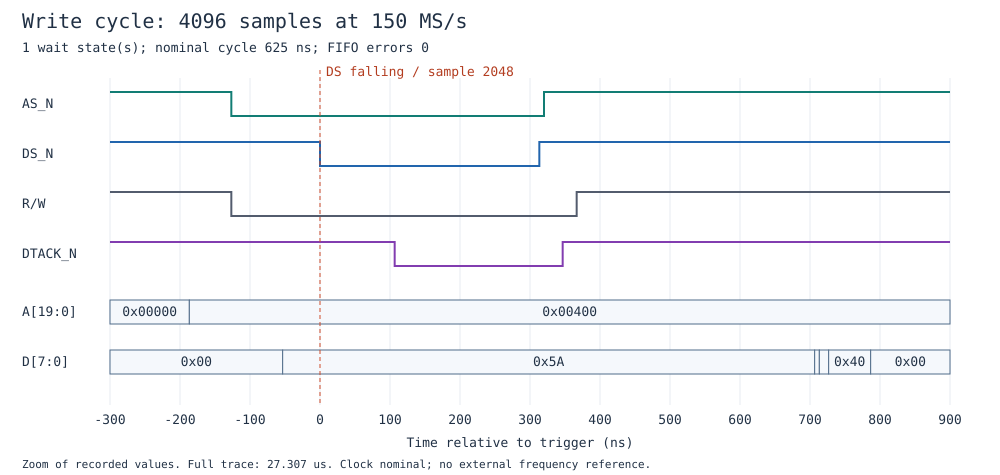

# Combined memory and 150 MS/s timing capture

Dispatcher 0.4 adds `memory --timing150`: a 1024-byte memory responder and
GPIO0..31 timing sampler on one Core2350B, with the bus generator on the other.
The previous memory application captured states; its 150 MHz timing analyzer
was separate, finite and lacked pre-trigger history.

4096 samples at 150 MHz span 27.3067 us with nominal 6.6667 ns spacing.
Middle triggering retains **2048 samples before /DS falls, and 2048 starting
at the sampled falling edge**. A no-wait 8 MHz cycle is nominally 500 ns,
or 75 sample intervals. Early/late positions and 1..4096 samples are supported.

## Validation status

Both images build with Pico SDK 2.3.1 and `-Wall -Wextra -Werror`; 39 host tests
pass, including the actual firmware trigger-window extraction across ring wraps,
missing/ambiguous edge rejection and waveform acceptance checks. All 11
dispatcher hardware acceptance checks also pass on the installed images.
Both boards were recovered through BOOTSEL and their programmed flash verified.

| Role | Serial | CDC port |
| --- | --- | --- |
| Generator, board 1 | F3217B63D8F6A7A5 | `/dev/cu.usbmodem24401` |
| Memory and timing, board 2 | AC740FAC748891BF | `/dev/cu.usbmodem24301` |

The following two-board captures contain exactly one complete acknowledged
transaction, correct address/data/direction, the requested trigger index and
**FDEBUG 0**. All contain 4096 samples at 150 MHz. Write data is `0x5a` at
address `0x00400`; reads return zero from freshly initialized RAM. Each run
also verifies all 1024 bytes of emulated memory after the transaction.

| Capture | DS trigger index | Wait states | Inferred nominal cycle |
| --- | ---: | ---: | ---: |
| Write, middle | 2048 | 1 | 625 ns |
| Read, middle | 2048 | 1 | 625 ns |
| Write, middle after 2.5 s | 2048 | 1 | 625 ns |
| Write, early | 409 | 1 | 625 ns |
| Read, late | 3686 | 2 | 750 ns |

Wait states are inferred from the captured AS/DS widths and generator phases.
There is no captured CLK or external frequency reference. The memory responder
currently adds one or two wait states; a 500 ns no-wait transaction has not
been demonstrated with this responder. The 2.5-second delay exercises endless
DMA beyond a finite 28-bit transfer count. A 100 ms no-cycle timeout saves 4096
samples with FDEBUG zero; the original finite analyzer was also checked.

[Write VCD](validation/timing150-2026-11-17/write.vcd) ·
[Read VCD](validation/timing150-2026-11-17/read.vcd)



## Wiring and commands

Use the [existing 3.3 V fixture bus](bus-fixture.md): A0..19 = GPIO0..19,
D0..7 = GPIO20..27, /AS = GPIO28, /DS = GPIO29, R/W = GPIO30, /DTACK = GPIO31.
This mode additionally drives **receiver GPIO32** as a local SIO-to-PIO permission
signal. The generator leaves GPIO32 as input, so its existing matching wire may
remain connected. Do not connect GPIO32 to another output. GPIO32 is FC0 on the
proposed adapter; this is bench firmware, not adapter firmware.

After both matching `build/multidrop/{1,2}/dispatcher.uf2` images are installed:

```sh
python3 tools/bus_timing.py \
  --generator /dev/cu.usbmodem24401 --receiver /dev/cu.usbmodem24301 \
  --allow-drive --allow-writes --output build/timing150/write.vcd
```

Omit `--allow-writes` for one read from initially zero-filled memory. The tool
prepares the source for one transaction, arms/starts the receiver, issues source
GO and downloads `.vcd`, `.bin`, capture `.json`, `.report.json` and the full
1024-byte `.memory.bin`, plus an `.svg` waveform preview. It checks
one complete cycle, exact trigger placement, address/data/direction stability,
DTACK ordering and memory contents. Measured AS/DS widths determine wait states;
total-cycle time is explicitly inferred from the PIO phases because there is
no captured external CLK. `--delay-ms 2500` tests long pre-trigger wrapping.
Use `--position early`, `middle` or `late` for 10/50/90-percent history.
`--timeout-ms` bounds the acquisition and must exceed the requested delay.

Independent operation, with the source prepared first:

```sh
python3 tools/ice.py --port /dev/cu.usbmodem24401 bus-generate \
  --allow-drive --allow-writes --cycles 1 --base 0x400 --prepare
python3 tools/ice.py --port /dev/cu.usbmodem24301 memory \
  --timing150 --allow-drive --samples 4096 --position middle \
  --strobe ds --edge assert --base 0x400 --timeout-ms 5000
python3 tools/ice.py --port /dev/cu.usbmodem24401 go
python3 tools/ice.py --port /dev/cu.usbmodem24301 fetch \
  --capture --output build/single-cycle.vcd
```

The client starts acquisition after the arm reply and allows 10 ms for startup.
Generate the cycle within the receiver timeout. Leave address/mask zero: this
mode uses the selected AS/DS edge. Small windows may omit other cycle edges and
fail the tool's complete-cycle check even when capture itself is valid.

## Implementation and limits

PIO0 SM0 samples one 32-bit word per system clock into a 32 KiB ring at
`0x20040000` using RP2350 endless DMA. PIO0 SM1 starts with the sampler, waits
for pre-trigger history, detects the selected edge and counts post-trigger
clocks. Its FIFO then requests a DMA write that stops sampling; a chained DMA
sets a completion flag in SRAM. Extra post-trigger samples cover hardware
latency. The stopped ring pointer and timer count locate the edge search region;
the recorded transition selects the exact window. Missing, ambiguous or
overwritten edges fail. No CPU peripheral reads are needed while sampling.

The worker serves RAM from SRAM using SIO. GPIO32 authorizes PIO2 DTACK only
for a decoded cycle, after read data is driven; DTACK releases with AS.
Worker IRQs are masked during acquisition; private SysTick supplies bus/overall
timeouts without shared peripheral reads. PSRAM copying, CRC and flash saving
happen after sampling. The generator's S7 end sequence was corrected to total
eight PIO ticks, making eight no-wait half-states exactly 64 ticks of its
nominal 128 MHz sequencer clock (500 ns).

**USB pauses during high-rate acquisition.** The dispatcher delivers GO's ACK,
parks core 0 with USB IRQs masked, and gives DMA bus priority. USB requests,
including status/abort/recovery, may wait until capture or automatic timeout.
Issue generator GO through its separate port and use a bounded receiver timeout.
SWD and physical BOOTSEL remain recovery paths. This fast mode is for one
verification window and stops RAM service when capture finishes; normal
lower-rate timing and state modes retain their existing operation.

Primary timing reference: [Motorola M68000 User's Manual, section 4](https://datasheets.chipdb.org/Motorola/68000/mc68000_userman.pdf).
PIO, DMA and SysTick use the pinned Raspberry Pi Pico SDK 2.3.1 definitions.

Retained [validation artifacts](validation/timing150-2026-11-17/) contain the
five cycle captures, VCD/raw data, waveform previews, memory dumps, metadata,
39-test log, dispatcher hardware results, build log and installed ELF hashes.
The earlier untriggered capture is retained with its acquisition provenance.
The build uses the [recorded toolchain](bringup.md#verification-evidence-2026-11-15)
(GCC 13.2.1, CMake 3.28.3, Ninja 1.11.1, Pico SDK/picotool 2.3.1).
